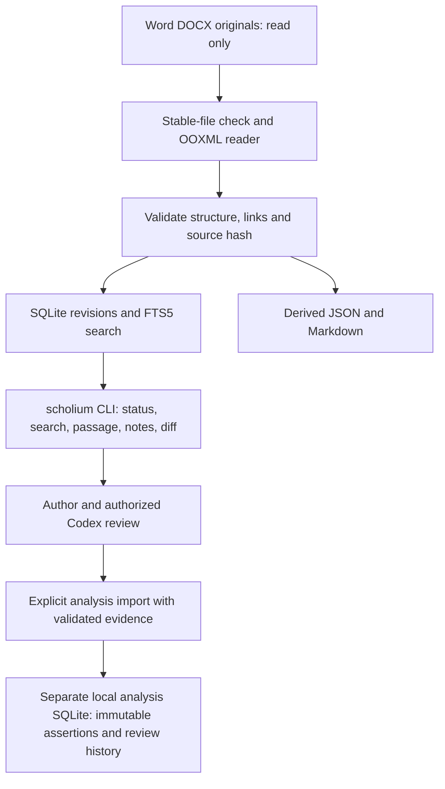

# Architecture

The executable is installed on PATH and operates on a book configuration discovered from the working directory or selected with `--config`. `scholium setup .` creates editable configuration; source paths and the data directory resolve relative to that file. Development location and book location are independent.

Python 3.12 is the provisional baseline, verified locally. Use standard-library ZIP/XML and SQLite where sufficient; evaluate XML parsing safety and complexity before Phase 2. Add watchdog only in Phase 4. Use pytest and a formatter/linter in Phase 1, pinning versions after actual clean-install validation.

Treat documents as untrusted input: bound archive expansion, disable external XML resolution, and never execute fields, macros, links, or embedded instructions. Read source bytes without write access; validate hash consistency across ingestion to detect concurrent saves. Reject unstable or incomplete files and retain the previous good revision.

SQLite is the structured index; Markdown is a disposable readable derivative. Commit a new current revision and its search records atomically only after successful validation. Exports identify their revision and may be rebuilt; a failed export must not masquerade as a current one.

Freshness is distinct from historical validity: compare the observed source hash with the successfully indexed hash. Changed, missing, unavailable, or failed sources remain visibly stale/unknown/error even while their old evidence is retrievable. Retrieval is read-only. Watcher events are hints; startup, periodic, and manual hash reconciliation catch missed saves.

Phase 2 implements setup/configuration/diagnostics plus a bounded standard-library OOXML reader and JSON/Markdown exports. SQLite storage, watchers and retrieval remain planned. Exports publish via a new temporary directory renamed into place after validation, with cooperative output locking and owner-only permissions. Extraction rechecks source hashes before returning and before publishing; it does not provide ongoing freshness monitoring. No model runs continuously. The default design sends no manuscript data over the network.

Phase 3 adds indexing.py (discovery/reconciliation/atomic ingestion), storage.py (schema 1 and read-only connections) and search.py (FTS5 retrieval/exports). See INDEX_SCHEMA.md and CLI.md for implemented contracts. Source and parser hashes define freshness; all retrieval includes a read-only source reconciliation. A corpus can be current yet carry extraction-fidelity warnings.

Phase 4 adds watcher.py: watchdog native event hints, debounce/stability checks, bounded per-file retry, foreground lock, and startup/periodic hash reconciliation. revisions.py supplies conservative identical-byte rename recovery plus read-only history/diffs. SQLite schema 2 records transition and path events and keeps full canonical revision snapshots. Migration backs up schema 1 before an atomic upgrade. No background service is installed.

Phase 6 adds a separate private analysis.sqlite3 (schema 1, application ID 1396918349). Source index remains schema 2. Analysis imports validate provenance against retained canonical revisions; reports dynamically reconcile current-role dependencies against source hashes/revision pointers. Historical baselines require current-role dependencies for the same document. Impact retrieval uses diffs and explicit lexical queries; interpretation occurs in the user-authorized conversation, never in a background provider.

Phase 7 adds verified snapshots and recovery to a new directory. Index/analysis writers hold shared OS maintenance locks; backup holds an exclusive lock plus SQLite write reservations while separate read connections produce snapshots. Backups include checksums and cross-database analysis-dependency validation. Restore verifies before and after copying without changing the active configuration. Integration helpers generate book-specific Codex instructions and optional login startup files without overwriting existing files or activating services.
